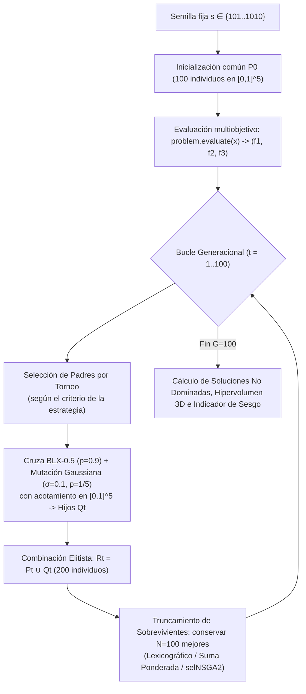
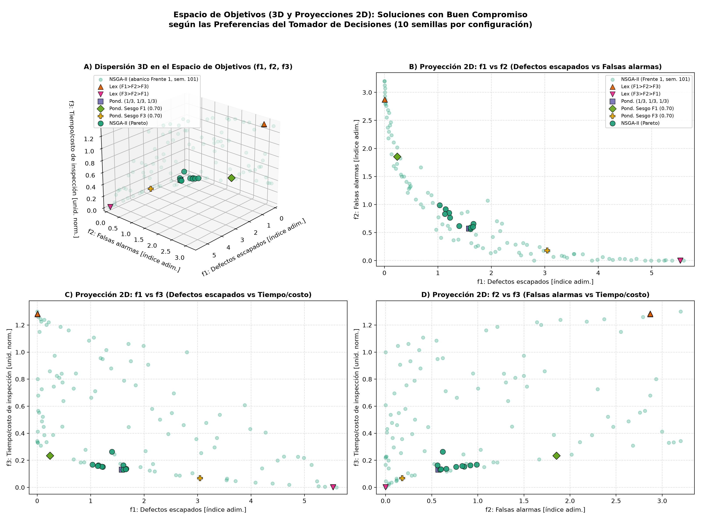
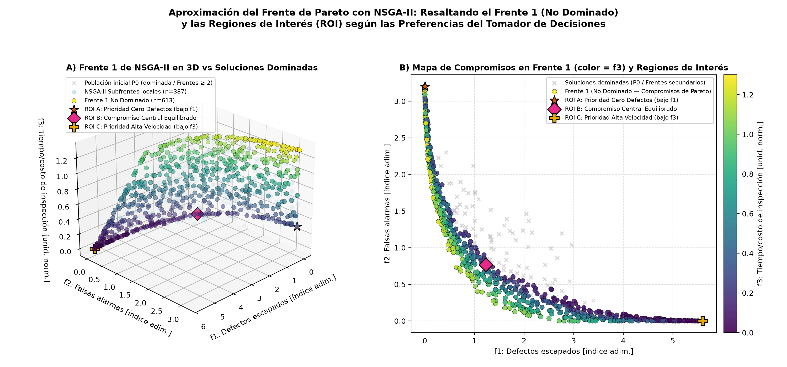
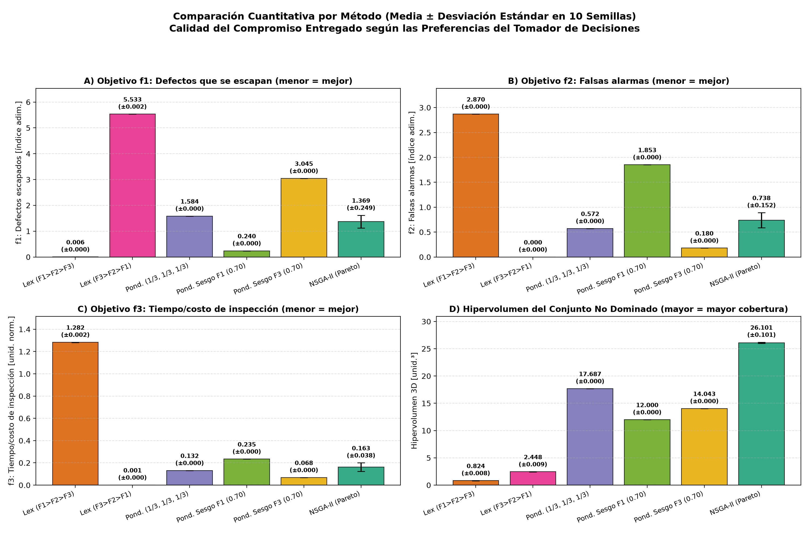
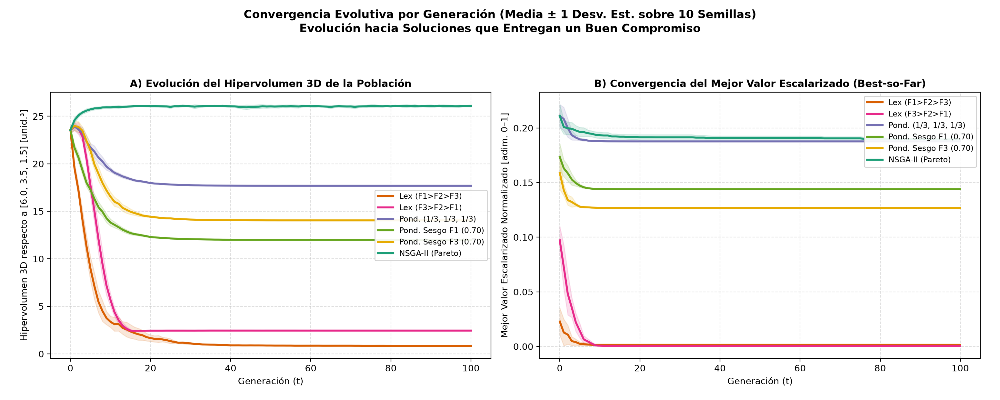
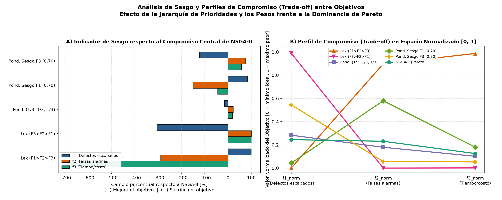

# Comparación de Enfoques Multiobjetivo con un Algoritmo Genético (Selección Lexicográfica, Suma Ponderada y NSGA-II)


-orange)
-success)

**Materia:** Optimización Inteligente — Maestría en Inteligencia Artificial y Analítica de Datos (MIAAD)  
**Autor:** Alan Navarro (`@Alan9890`)

> **Convención Terminológica Obligatoria:** En congruencia con los criterios metodológicos de la materia, en este repositorio, su documentación y sus gráficas nunca se emplea la expresión *"solución óptima"*; se utiliza siempre **"solución que entrega un buen compromiso según las preferencias del tomador de decisiones"**.

---

## Tabla de Contenidos

1. [Resumen Ejecutivo y Documentación del Proyecto](#1-resumen-ejecutivo-y-documentación-del-proyecto)
2. [Fundamento Teórico de los Tres Enfoques](#2-fundamento-teórico-de-los-tres-enfoques)
3. [Definición Matemática del Problema (`problem.py`)](#3-definición-matemática-del-problema-problempy)
4. [Arquitectura del Repositorio y Flujo Experimental](#4-arquitectura-del-repositorio-y-flujo-experimental)
5. [Guía de Ejecución Paso a Paso por Etapas](#5-guía-de-ejecución-paso-a-paso-por-etapas)
6. [Resultados Experimentales y Tablas Comparativas (10 Semillas)](#6-resultados-experimentales-y-tablas-comparativas-10-semillas)
7. [Análisis Visual Detallado de las Gráficas Generadas](#7-análisis-visual-detallado-de-las-gráficas-generadas)
8. [Ventajas y Deficiencias por Método (basadas en los datos obtenidos)](#8-ventajas-y-deficiencias-por-método-basadas-en-los-datos-obtenidos)
9. [Contrastación de Hipótesis](#9-contrastación-de-hipótesis)
10. [Esquema de Presentación (10 Diapositivas)](#10-esquema-de-presentación-10-diapositivas)
11. [Cómo Reemplazar con el Problema Oficial del Profesor](#11-cómo-reemplazar-con-el-problema-oficial-del-profesor)

---

## 1. Resumen Ejecutivo y Documentación del Proyecto

Este proyecto evalúa y compara de manera controlada **tres filosofías para medir la calidad y seleccionar soluciones** dentro de un problema **multiobjetivo con 3 objetivos en conflicto**, utilizando exactamente **la misma metaheurística base (Algoritmo Genético)** en todos los escenarios:

1. **Selección Lexicográfica** ($F_1 > F_2 > F_3$ y segunda permutación $F_3 > F_2 > F_1$, con tolerancia relativa configurable $\tau = 10^{-3}$).
2. **Suma Ponderada con Normalización Min-Max Previa** ($F(\mathbf{x}) = \sum_{i=1}^3 w_i \hat{f}_i(\mathbf{x})$ con $\sum w_i = 1$, probando pesos parejos $(1/3, 1/3, 1/3)$, sesgo a $F_1$ $(0.70, 0.15, 0.15)$ y sesgo a $F_3$ $(0.15, 0.15, 0.70)$).
3. **Dominancia de Pareto con NSGA-II** (ordenamiento rápido no dominado en Frente 1, Frente 2, ..., distancia de hacinamiento *crowding distance* y truncamiento elitista $R_t = P_t \cup Q_t$ con `deap.tools.selNSGA2`).

### Documentación Detallada en `docs/`
- [**`docs/01_TEORIA_Y_FUNDAMENTOS.md`**](docs/01_TEORIA_Y_FUNDAMENTOS.md): Explicación teórica desde cero (Monoobjetivo vs Multiobjetivo, *Trade-off*, Dominancia de Pareto $A \prec B$, Frente de Pareto, Región de Interés ROI, normalización en Suma Ponderada y ejemplo numérico paso a paso de NSGA-II).
- [**`docs/02_ARQUITECTURA_Y_CODIGO.md`**](docs/02_ARQUITECTURA_Y_CODIGO.md): Detalle de la arquitectura modular en Python, operadores genéticos idénticos (`BLX-0.5` y mutación gaussiana $\sigma=0.1$), manejo de tolerancia lexicográfica y guía de adaptación.
- [**`docs/03_GUIA_PRESENTACION.md`**](docs/03_GUIA_PRESENTACION.md): Guion completo para la presentación de 10 diapositivas con notas de orador.
- **Material HTML de referencia teórica:** [`Intro.html`](Intro.html), [`multiobjetivo-pareto.html`](multiobjetivo-pareto.html), [`NSGA-II 1.html`](NSGA-II%201.html) y [`nsga-ii.html`](nsga-ii.html).

---

## 2. Fundamento Teórico de los Tres Enfoques

En un problema multiobjetivo $\min_{\mathbf{x} \in \Omega} \mathbf{F}(\mathbf{x}) = (f_1(\mathbf{x}), f_2(\mathbf{x}), f_3(\mathbf{x}))^T$ donde los criterios compiten entre sí, mejorar un objetivo deteriora inevitablemente otro (*trade-off*). La estructura del Algoritmo Genético se mantiene fija y solo varía la regla de preferencia entre soluciones:

| Característica | 1. Selección Lexicográfica | 2. Suma Ponderada Normalizada | 3. Dominancia de Pareto (NSGA-II) |
| :--- | :--- | :--- | :--- |
| **Principio matemático** | Orden total por prioridad absoluta $F_{p_1} \succ F_{p_2} \succ F_{p_3}$ con umbral relativo $\tau = 10^{-3}$. | Escalarización lineal $F(\mathbf{x}) = \sum_{i=1}^3 w_i \hat{f}_i(\mathbf{x})$ con $\hat{f}_i \in [0, 1]$ y $\sum w_i = 1$. | Orden parcial de Pareto ($A \prec B \iff \forall i: f_i(A) \le f_i(B) \land \exists j: f_j(A) < f_j(B)$) + *Crowding Distance*. |
| **Momento en que se fijan preferencias** | *A priori* (jerarquía rígida de objetivos). | *A priori* (vector de pesos $\mathbf{w}$). | *A posteriori* (el decisor analiza el Frente 1 y elige su Región de Interés ROI). |
| **Comportamiento de la población final** | Se concentra en una esquina extrema del espacio de objetivos. | Colapsa en un único punto sobre la parte convexa del frente. | Se distribuye uniformemente a lo largo de todo el **Frente 1** ($\approx 100$ soluciones no dominadas). |

---

## 3. Definición Matemática del Problema (`problem.py`)

Se modela el problema de **Configuración de Inspección Óptica Automatizada en una Línea SMT** (*Surface Mount Technology*) con **5 variables de decisión continuas** en $[0, 1]$:

$$\mathbf{x} = (s_1, s_2, s_3, s_4, v) \in [0, 1]^5$$

- $s_1, s_2, s_3, s_4 \in [0, 1]$: Sensibilidad de detección para 4 clases de defecto.
- $v \in [0, 1]$: Velocidad normalizada de inspección de la línea.

### Los 3 Objetivos a Minimizar

1. **Defectos que se escapan al cliente ($f_1$):**
   $$f_1(\mathbf{x}) = (1 + v)\sum_{i=1}^{4} a_i (1 - s_i)^2, \quad \mathbf{a} = [1.0,\, 0.8,\, 0.6,\, 0.4], \quad f_1 \in [0.0,\, 5.6]$$
2. **Falsas alarmas / retrabajos innecesarios ($f_2$):**
   $$f_2(\mathbf{x}) = \sum_{i=1}^{4} b_i s_i^2, \quad \mathbf{b} = [0.5,\, 0.7,\, 0.9,\, 1.1], \quad f_2 \in [0.0,\, 3.2]$$
3. **Tiempo y costo operativo de inspección ($f_3$):**
   $$f_3(\mathbf{x}) = (1 - v) + 0.3\,\bar{s}, \quad \bar{s} = \frac{1}{4}\sum_{i=1}^{4} s_i, \quad f_3 \in [0.0,\, 1.3]$$

### Análisis Físico del Conflicto
- Minimizar $f_1 \to 0$ exige sensibilidades máximas ($s_i \to 1$) y baja velocidad ($v \to 0$), lo cual maximiza las falsas alarmas ($f_2 \to 3.2$) y el tiempo de inspección ($f_3 \to 1.3$).
- Minimizar $f_2 \to 0$ y $f_3 \to 0$ exige apagar los sensores ($s_i \to 0$) y acelerar la banda al máximo ($v \to 1$), provocando el escape total de defectos ($f_1 \to 5.6$).
- Debido a que $a_1 > a_2 > a_3 > a_4$ y $b_1 < b_2 < b_3 < b_4$, la clase de defecto 1 es la más crítica y menos propensa a falsas alarmas, por lo que **toda solución que entrega un buen compromiso cumple $s_1 > s_2 > s_3 > s_4$**.

*(El archivo `problem.py` incluye además el problema clásico **DTLZ2** de 3 objetivos como validación opcional cambiando `ACTIVE_PROBLEM = "DTLZ2"`).*

---

## 4. Arquitectura del Repositorio y Flujo Experimental

```text
.
├── problem.py                 # evaluate(x) -> (f1, f2, f3), bounds, normalización y punto de ref. HV
├── ga_core.py                 # Diccionario GA_CONFIG, cruza BLX-0.5/SBX, mutación gaussiana y bucle GA
├── strategies.py              # Lexicográfica, Suma Ponderada normalizada y NSGA-II (deap.tools.selNSGA2)
├── run_experiments.py         # Ejecuta 6 configuraciones × 10 semillas fijas (60 corridas) y guarda CSV
├── analysis.py                # Calcula métricas, indicador de sesgo y genera las 5 gráficas a 200 dpi
├── requirements.txt           # Dependencias reproducibles (deap, numpy, pandas, matplotlib, moocore)
├── README.md                  # Documentación integral del repositorio
├── docs/                      # Guías teóricas, de arquitectura y de presentación
│   ├── 01_TEORIA_Y_FUNDAMENTOS.md
│   ├── 02_ARQUITECTURA_Y_CODIGO.md
│   └── 03_GUIA_PRESENTACION.md
└── results/                   # Resultados CSV y figuras PNG de alta resolución (200 dpi)
    ├── runs_summary.csv
    ├── final_populations.csv
    ├── convergence_history.csv
    ├── metrics_comparison.csv
    ├── fig1_espacio_objetivos_3d_2d.png
    ├── fig2_frente_pareto_nsga2.png
    ├── fig3_barras_objetivos.png
    ├── fig4_convergencia_generaciones.png
    └── fig5_indicador_sesgo_tradeoff.png
```



---

## 5. Guía de Ejecución Paso a Paso por Etapas

### Instalación de dependencias
```bash
pip install -r requirements.txt
```

### Etapa 1: Prueba rápida de `problem.py` y `ga_core.py`
```bash
python problem.py
python ga_core.py
```
- **Qué verifica:** Evalúa las configuraciones límite de la línea SMT, comprueba la normalización min-max en $[0, 1]$, inicializa una población de prueba y calcula el hipervolumen 3D inicial respecto a $\mathbf{r} = [6.0, 3.5, 1.5]$.

### Etapa 2: Prueba comparativa de `strategies.py` (1 semilla)
```bash
python strategies.py
```
- **Qué verifica:** Corre las 6 configuraciones durante 100 generaciones con la semilla `101` e imprime la solución de compromiso, el número de soluciones no dominadas y el hipervolumen de cada enfoque.

### Etapa 3: Experimento completo con múltiples semillas (`run_experiments.py`)
```bash
python run_experiments.py
```
- **Qué hace:** Ejecuta las **6 configuraciones $\times$ 10 semillas fijas = 60 corridas independientes** ($100$ individuos $\times$ $100$ generaciones cada una) y exporta `runs_summary.csv`, `final_populations.csv` y `convergence_history.csv` en `results/`.

### Etapa 4: Análisis estadístico y generación de gráficas (`analysis.py`)
```bash
python analysis.py
```
- **Qué hace:** Genera `results/metrics_comparison.csv` y las 5 figuras PNG a `200 dpi` en `results/`.

---

## 6. Resultados Experimentales y Tablas Comparativas (10 Semillas)

### Parámetros Fijos del Experimento (`GA_CONFIG`)
- **Población ($N$):** `100` individuos | **Generaciones ($G$):** `100`
- **Cruza:** Blend Crossover (`BLX-0.5`), probabilidad `0.90` | **Mutación:** Gaussiana ($\sigma = 0.1$), probabilidad por gen $1/5 = 0.20$
- **Semillas fijas reportadas (10):** `[101, 202, 303, 404, 505, 606, 707, 808, 909, 1010]`
- **Punto de referencia común de Hipervolumen:** $\mathbf{r} = [6.0,\, 3.5,\, 1.5]$ (espacio original) y $\mathbf{r}_{\text{norm}} = [1.1,\, 1.1,\, 1.1]$ (espacio normalizado).

### 6.1. Tabla de Desempeño por Método (Media ± Desviación Estándar)

| Configuración / Enfoque | $f_1$ (Defectos escapados) | $f_2$ (Falsas alarmas) | $f_3$ (Tiempo/costo) | Soluciones No Dominadas | Hipervolumen 3D ($\text{ref}=[6.0, 3.5, 1.5]$) | Hipervolumen Normalizado | Variables medias $(s_1, s_2, s_3, s_4, v)$ |
| :--- | :---: | :---: | :---: | :---: | :---: | :---: | :---: |
| **Lexicográfica ($F_1 > F_2 > F_3$)** | **0.0056 ± 0.0000** | 2.8703 ± 0.0001 | 1.2820 ± 0.0020 | 2.1 ± 1.1 | 0.824 ± 0.008 | 0.025 ± 0.000 | $(0.98, 0.97, 0.95, 0.91, 0.00)$ |
| **Lexicográfica ($F_3 > F_2 > F_1$)** | 5.5334 ± 0.0018 | **0.0001 ± 0.0000** | **0.0013 ± 0.0000** | 1.0 ± 0.0 | 2.448 ± 0.009 | 0.135 ± 0.000 | $(0.02, 0.00, 0.00, 0.00, 1.00)$ |
| **Suma Ponderada $(1/3, 1/3, 1/3)$** | 1.5844 ± 0.0000 | 0.5724 ± 0.0000 | 0.1318 ± 0.0000 | 1.0 ± 0.0 | 17.687 ± 0.000 | 0.752 ± 0.000 | $(0.64, 0.51, 0.37, 0.23, 1.00)$ |
| **Suma Ponderada Sesgo $F_1$ $(0.70, 0.15, 0.15)$** | 0.2404 ± 0.0000 | 1.8535 ± 0.0000 | 0.2346 ± 0.0000 | 1.0 ± 0.0 | 12.000 ± 0.000 | 0.506 ± 0.000 | $(0.90, 0.84, 0.76, 0.63, 1.00)$ |
| **Suma Ponderada Sesgo $F_3$ $(0.15, 0.15, 0.70)$** | 3.0453 ± 0.0000 | 0.1803 ± 0.0000 | 0.0683 ± 0.0000 | 1.0 ± 0.0 | 14.043 ± 0.000 | 0.608 ± 0.000 | $(0.43, 0.30, 0.16, 0.02, 1.00)$ |
| **NSGA-II (Dominancia de Pareto)** | 1.3692 ± 0.2485 | 0.7385 ± 0.1525 | 0.1625 ± 0.0378 | **99.9 ± 0.3** | **26.101 ± 0.101** | **1.104 ± 0.004** | $(0.75, 0.53, 0.43, 0.24, 0.98)$ |

### 6.2. Indicador de Sesgo (% de Mejora `[+]` o Sacrificio `[-]` por Objetivo)

El indicador de sesgo cuantifica cuánto reduce ($+$, mejora) o incrementa ($-$, empeora) cada objetivo un método dado respecto a la solución compromiso central de **NSGA-II** (y entre paréntesis respecto a la **Suma Ponderada Equilibrada**):

$$\text{Sesgo}_k(\%) = \frac{f_k^{\text{ref}} - f_k^{\text{método}}}{f_k^{\text{ref}}} \times 100$$

| Configuración / Enfoque | Sesgo en $f_1$ vs NSGA-II (vs Equil.) | Sesgo en $f_2$ vs NSGA-II (vs Equil.) | Sesgo en $f_3$ vs NSGA-II (vs Equil.) | Comportamiento Observado |
| :--- | :---: | :---: | :---: | :--- |
| **Lexicográfica ($F_1 > F_2 > F_3$)** | **+99.6%** (+99.6%) | −288.7% (−401.5%) | −688.8% (−872.7%) | Mejora casi al $100\%$ $f_1$, pero sacrifica severamente $f_2$ y $f_3$. |
| **Lexicográfica ($F_3 > F_2 > F_1$)** | −304.1% (−249.2%) | **+100.0%** (+100.0%) | **+99.2%** (+99.0%) | Minimiza al extremo $f_3$ y $f_2$, pero triplica los defectos escapados $f_1$. |
| **Suma Ponderada $(1/3, 1/3, 1/3)$** | −15.7% (0.0%) | +22.5% (0.0%) | +18.9% (0.0%) | Compromiso equilibrado puntual con ligera ventaja en $f_2$ y $f_3$. |
| **Suma Ponderada Sesgo $F_1$ $(0.70, 0.15, 0.15)$** | **+82.4%** (+84.8%) | −151.0% (−223.8%) | −44.4% (−78.0%) | Se sesga claramente hacia $f_1$ penalizando las falsas alarmas $f_2$. |
| **Suma Ponderada Sesgo $F_3$ $(0.15, 0.15, 0.70)$** | −122.4% (−92.2%) | +75.6% (+68.5%) | **+58.0%** (+48.2%) | Se sesga hacia rapidez de inspección $f_3$ a costa de duplicar $f_1$. |
| **NSGA-II (Dominancia de Pareto)** | 0.0% (+13.6%) | 0.0% (−29.0%) | 0.0% (−23.3%) | Conserva el abanico completo de compromisos ($\text{HV}=26.101$). |

---

## 7. Análisis Visual Detallado de las Gráficas Generadas

### 7.1. Dispersión 3D y Proyecciones 2D en el Espacio de Objetivos (`fig1`)



**Interpretación:**
- Todos los paneles comparten exactamente el mismo rango de ejes para permitir una comparación visual directa.
- **Lexicográfica ($F_1 > F_2 > F_3$, triángulos naranjas):** Se ubica en el extremo superior izquierdo ($f_1 \approx 0.006, f_2 \approx 2.87, f_3 \approx 1.28$), donde prácticamente no se escapan defectos pero la línea opera al mínimo de velocidad y con máximas falsas alarmas.
- **Lexicográfica ($F_3 > F_2 > F_1$, triángulos magentas):** Se ubica en el extremo opuesto inferior derecho ($f_1 \approx 5.53, f_2 \approx 0.0001, f_3 \approx 0.0013$).
- **Sumas Ponderadas (cuadrados violetas, rombos verdes, cruces doradas):** Cada configuración de pesos converge de manera determinista a un único punto sobre la sección inferior ($v = 1.0$) del frente, desplazándose a la izquierda cuando $w_1 = 0.70$ y a la derecha cuando $w_3 = 0.70$.
- **NSGA-II (círculos verde azulado):** Cubre toda la superficie tridimensional de compromisos eficientes en una sola ejecución.

---

### 7.2. Frente de Pareto de NSGA-II y Regiones de Interés (`fig2`)



**Interpretación:**
- Contrasta las soluciones dominadas de la población aleatoria inicial $P_0$ (cruces grises) y subfrentes locales frente al **Frente 1 No Dominado** (coloreado según el valor de $f_3$).
- Ilustra cómo el tomador de decisiones puede elegir *a posteriori* su **Región de Interés (ROI)** sobre el Frente 1:
  - **ROI A (Estrella naranja):** Prioridad cero defectos ($f_1 \to 0$).
  - **ROI B (Rombo magenta):** Compromiso central equilibrado entre los 3 objetivos.
  - **ROI C (Cruz dorada):** Prioridad máxima velocidad y mínimo costo de ciclo ($f_3 \to 0$).

---

### 7.3. Comparación Cuantitativa por Objetivo e Hipervolumen (`fig3`)



**Interpretación:**
- Los paneles **A, B y C** muestran la media $\pm$ desviación estándar de $f_1, f_2$ y $f_3$ sobre las 10 semillas, evidenciando la naturaleza del *trade-off*: ninguna barra es simultáneamente baja en los tres paneles.
- El panel **D (Hipervolumen 3D)** muestra que **NSGA-II alcanza $26.101 \pm 0.101$**, superando ampliamente a la Suma Ponderada equilibrada ($17.687$), a las sumas ponderadas sesgadas ($12.000$ y $14.043$) y a las selecciones lexicográficas ($0.824$ y $2.448$).

---

### 7.4. Dinámica de Convergencia por Generación (`fig4`)



**Interpretación:**
- **Panel A (Evolución del Hipervolumen 3D de la Población $P_t$):** En la generación $t=0$, las 6 estrategias parten de la misma población aleatoria $P_0$ con hipervolumen $\approx 23.6$. Conforme avanzan las generaciones, **NSGA-II incrementa el hipervolumen hasta $26.101$** al empujar los 100 individuos hacia el Frente 1 manteniendo su dispersión con *crowding distance*. Por el contrario, en Suma Ponderada y Selección Lexicográfica el hipervolumen de la población *disminuye* conforme los 100 individuos colapsan hacia un único punto del espacio, perdiendo la cobertura de las demás regiones del frente.
- **Panel B (Convergencia del Mejor Valor Escalarizado *Best-so-Far*):** Verifica que el Algoritmo Genético converge de forma monótona y estable antes de la generación 30–40 en todos los métodos bajo su respectivo criterio de calidad.

---

### 7.5. Indicador de Sesgo y Perfiles de Compromiso en Coordenadas Paralelas (`fig5`)



**Interpretación:**
- **Panel A:** Visualiza el indicador de sesgo porcentual respecto a NSGA-II. Se observa el sesgo extremo de las variantes lexicográficas ($+99.6\%$ en $f_1$ contra $-688.8\%$ en $f_3$) y el sesgo controlado pero marcado de las sumas ponderadas cuando se varía $\mathbf{w}$.
- **Panel B (Coordenadas Paralelas Normalizadas $[0, 1]$):** Los cruces de líneas entre `f1_norm` y `f2_norm` son la firma visual de objetivos en conflicto severo. Mientras las estrategias lexicográficas tocan los bordes $0.0$ y $1.0$, la Suma Ponderada $(1/3, 1/3, 1/3)$ y el compromiso central de NSGA-II mantienen un perfil bajo y equilibrado en los tres ejes ($\le 0.28$).

---

## 8. Ventajas y Deficiencias por Método (basadas en los datos obtenidos)

### 1. Selección Lexicográfica
La **Selección Lexicográfica** presenta la ventaja de ser sumamente intuitiva cuando el tomador de decisiones posee una jerarquía estricta e innegociable de prioridades, pues no requiere definir pesos numéricos ni escalas entre criterios. En nuestros experimentos, bajo el orden $F_1 > F_2 > F_3$ (con tolerancia relativa $10^{-3}$), el método redujo los defectos escapados a $f_1 = 0.0056 \pm 0.0000$ (una mejora del $+99.6\%$ respecto a NSGA-II), y dentro de ese escalón de empate utilizó $F_2$ para moderar ligeramente las sensibilidades frenando la banda transportadora ($v = 0.004$). Sin embargo, su deficiencia crítica es que actúa como una "dictadura de prioridades" que ignora el *trade-off* global: deterioró las falsas alarmas en $-288.7\%$ ($f_2 = 2.8703$) y el tiempo/costo en $-688.8\%$ ($f_3 = 1.2820$), colapsando la población a solo $2.1$ soluciones no dominadas con un hipervolumen mínimo de $0.824$. Además, es extremadamente sensible al orden de prioridad: al permutar a $F_3 > F_2 > F_1$, la solución saltó al extremo opuesto del espacio ($f_3 = 0.0013, f_2 = 0.0001$), disparando los defectos escapados hasta $f_1 = 5.5334$ ($-304.1\%$).

### 2. Suma Ponderada Normalizada
La **Suma Ponderada** (previa normalización min-max de cada objetivo a $[0, 1]$) tiene la ventaja de incorporar simultáneamente la sinergia de los tres objetivos en una sola función escalar $F(\mathbf{x}) = \sum w_i \hat{f}_i(\mathbf{x})$, mostrando una convergencia sumamente rápida y estable (desviación estándar $< 10^{-5}$ entre las 10 semillas) hacia una solución que entrega un buen compromiso puntual según los pesos fijados ($f_1 = 1.5844, f_2 = 0.5724, f_3 = 0.1318$ con hipervolumen de $17.687$ en el caso equilibrado $1/3, 1/3, 1/3$). No obstante, presenta tres deficiencias fundamentales: (1) exige que el tomador de decisiones conozca y cuantifique sus pesos *a priori* antes de conocer la geometría del conflicto; (2) sesga fuertemente la búsqueda hacia el objetivo de mayor peso —al asignar $w_1 = 0.70$, $f_1$ mejora $+82.4\%$ ($0.2404$) pero $f_2$ empeora $-151.0\%$ ($1.8535$), mientras que con $w_3 = 0.70$, $f_3$ baja a $0.0683$ ($+58.0\%$) pero $f_1$ sube a $3.0453$ ($-122.4\%$)—; y (3) colapsa toda la población del algoritmo genético en **1 única solución no dominada** ($1.0 \pm 0.0$) por corrida, siendo además matemáticamente incapaz de explorar regiones cóncavas del Frente de Pareto.

### 3. Dominancia de Pareto con NSGA-II
El enfoque basado en **Dominancia de Pareto mediante NSGA-II** (ordenamiento rápido por frentes no dominados, *crowding distance* para preservar diversidad y truncamiento elitista $R_t = P_t \cup Q_t$) supera la pérdida de diversidad de los métodos escalares al mantener una población distribuida sobre toda la frontera de eficiencia: alcanzó un promedio de **$99.9 \pm 0.3$ soluciones no dominadas** en el Frente 1 por corrida y el mayor **hipervolumen 3D con $26.101 \pm 0.101$** (superando en $+47.6\%$ a la suma ponderada equilibrada y en $+3067\%$ a la selección lexicográfica). Su principal ventaja práctica es que no obliga al experto a adivinar pesos a ciegas, sino que le entrega un mapa completo de compromisos donde puede elegir *a posteriori* su **Región de Interés (ROI)** (por ejemplo, el compromiso central $f_1 = 1.3692, f_2 = 0.7385, f_3 = 0.1625$, o cualquier extremo operativo). Como deficiencia, implica un costo computacional mayor por generación debido al ordenamiento no dominado y cálculo de distancias de hacinamiento ($4.87\text{ s}$ vs $0.35\text{ s}$ por corrida), y transfiere al tomador de decisiones la tarea posterior de seleccionar una solución final entre las $\approx 100$ alternativas del Frente 1.

---

## 9. Contrastación de Hipótesis

| Hipótesis Planteada | Veredicto Experimental | Evidencia Cuantitativa |
| :--- | :---: | :--- |
| **H1 (Lexicográfica):** *Mejora mucho el objetivo prioritario y descuida los demás.* | **Confirmada** | En $F_1 > F_2 > F_3$, $f_1$ mejora $+99.6\%$ ($0.0056$), mientras $f_2$ y $f_3$ se degradan $-288.7\%$ y $-688.8\%$. |
| **H2 (Suma Ponderada):** *Se sesga hacia el objetivo con mayor peso; los pesos hay que definirlos de antemano.* | **Confirmada** | Cambiar $\mathbf{w}$ de $(0.70, 0.15, 0.15)$ a $(0.15, 0.15, 0.70)$ desplaza $f_1$ de $0.2404$ a $3.0453$ y colapsa la población a $1.0$ solución no dominada. |
| **H3 (NSGA-II):** *Entrega un conjunto de compromisos; el tomador de decisiones elige después (región de interés).* | **Confirmada** | Encuentra $99.9 \pm 0.3$ soluciones no dominadas en el Frente 1 con $\text{HV} = 26.101 \pm 0.101$, cubriendo las tres Regiones de Interés (ROI A, B y C). |

---

## 10. Esquema de Presentación (10 Diapositivas)

*(El guion completo con notas de orador se encuentra en [`docs/03_GUIA_PRESENTACION.md`](docs/03_GUIA_PRESENTACION.md)).*

1. **Diapositiva 1 — Portada y Premisa Metodológica:** Contexto del problema multiobjetivo y uso riguroso del concepto *"solución que entrega un buen compromiso según las preferencias del tomador de decisiones"*.
2. **Diapositiva 2 — Problema de Inspección SMT y Objetivos en Conflicto:** Variables $(s_1, s_2, s_3, s_4, v) \in [0, 1]^5$ y formulación de $f_1, f_2, f_3$.
3. **Diapositiva 3 — Los 3 Enfoques bajo la Misma Metaheurística:** Selección Lexicográfica, Suma Ponderada Normalizada y Dominancia de Pareto (NSGA-II).
4. **Diapositiva 4 — Configuración Experimental Controlada:** Diccionario `GA_CONFIG` ($N=100, G=100$, BLX-$0.5$, mutación gaussiana $\sigma=0.1$), 6 configuraciones, 10 semillas fijas y referencia común de hipervolumen $[6.0, 3.5, 1.5]$.
5. **Diapositiva 5 — Espacio de Objetivos 3D y Proyecciones 2D:** Análisis espacial con `results/fig1_espacio_objetivos_3d_2d.png`.
6. **Diapositiva 6 — Frente de Pareto de NSGA-II y Regiones de Interés (ROI):** Análisis del Frente 1 y las zonas ROI A, B y C con `results/fig2_frente_pareto_nsga2.png`.
7. **Diapositiva 7 — Comparación Cuantitativa por Objetivo e Hipervolumen:** Gráfica de barras `results/fig3_barras_objetivos.png` y tabla estadística de las 60 corridas.
8. **Diapositiva 8 — Convergencia Generacional e Indicador de Sesgo:** Análisis dinámico con `results/fig4_convergencia_generaciones.png` y `results/fig5_indicador_sesgo_tradeoff.png`.
9. **Diapositiva 9 — Ventajas y Deficiencias por Enfoque:** Cuadro comparativo basado en la evidencia experimental.
10. **Diapositiva 10 — Conclusiones y Cierre:** Elección de un buen compromiso según las preferencias del decisor y perspectiva hacia la **Lógica Difusa Compensatoria** (media geométrica).

---

## 11. Cómo Reemplazar con el Problema Oficial del Profesor

Para cambiar al problema e instancia oficial del profesor sin alterar el motor evolutivo:

1. Abrir [`problem.py`](problem.py) y sustituir la función `evaluate(x)` con la función de evaluación oficial.
2. Ajustar `N_VARS`, `VAR_NAMES`, `BOUNDS`, `OBJ_MIN`, `OBJ_MAX` y `HV_REF_POINT`.
3. **No modificar `ga_core.py` ni `strategies.py`** (si el problema usa variables discretas o permutaciones, adaptar únicamente la inicialización, cruza y mutación en `ga_core.py` manteniéndolas idénticas para los tres métodos).
4. Re-ejecutar:
   ```bash
   python run_experiments.py
   python analysis.py
   ```
