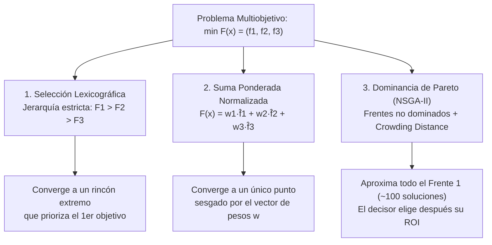

# Fundamentos Teóricos de la Optimización Multiobjetivo y NSGA-II

**Materia:** Optimización Inteligente — Maestría en Inteligencia Artificial y Analítica de Datos (MIAAD)

> **Convención Terminológica Rigurosa:** En problemas multiobjetivo con criterios en conflicto y dimensiones continuas o combinatorias complejas, no se puede garantizar ni afirmar que una solución única sea la *"solución óptima"* absoluta. Por ello, en todo este proyecto empleamos el término:  
> **"Solución que entrega un buen compromiso según las preferencias del tomador de decisiones"**.

---

## 1. De la Optimización Monoobjetivo a la Multiobjetivo

### 1.1. Optimización Monoobjetivo
En los problemas clásicos monoobjetivo se busca minimizar o maximizar una **única función escalar** $f(\mathbf{x})$:

$$\min_{\mathbf{x} \in \Omega} f(\mathbf{x})$$

donde $\mathbf{x} = (x_1, x_2, \dots, x_n)$ es el vector de variables de decisión y $\Omega$ es el espacio de soluciones factibles.  
- **Comparación:** Existe un **orden total** ($f(A) < f(B) \implies A$ es mejor que $B$).
- **Analogía:** Buscar la ruta más corta entre casa y la universidad considerando únicamente la distancia en kilómetros.

### 1.2. Optimización Multiobjetivo (MOP / Multicriterio)
En la industria y la ingeniería, las decisiones rara vez dependen de un solo criterio. Un problema de optimización multiobjetivo busca optimizar simultáneamente un vector de $k \ge 2$ funciones objetivo:

$$\min_{\mathbf{x} \in \Omega} \mathbf{F}(\mathbf{x}) = \big(f_1(\mathbf{x}),\, f_2(\mathbf{x}),\, \dots,\, f_k(\mathbf{x})\big)^T$$

*(En la literatura se denomina **biobjetivo** cuando $k=2$, **multiobjetivo** o **multicriterio** cuando $3 \le k \le 15$, y **many-objective** cuando $k \ge 16$).*

- **El paradigma cambia:** Cada función $f_i(\mathbf{x})$ mide una dimensión distinta (con sus propias unidades, escalas y reglas). Ya no existe una solución perfecta que gane simultáneamente en todos los criterios.

---

## 2. El Concepto de *Trade-off* (Compromiso), Dominancia y Frente de Pareto

### 2.1. El Conflicto entre Objetivos (*Trade-off*)
Cuando los objetivos están en conflicto, mejorar uno provoca inevitablemente el deterioro de al menos otro. A este fenómeno se le denomina **compromiso** (*trade-off*). Por ejemplo:
- En una **línea de inspección SMT**, elevar la sensibilidad de las cámaras reduce los defectos que se escapan al cliente ($f_1$), pero incrementa las falsas alarmas ($f_2$) y el tiempo de revisión ($f_3$).
- En un **dron agrícola**, reducir el peso total disminuye la capacidad de batería y el tiempo de vuelo.

### 2.2. Dominancia de Pareto ($\prec$)
Dado que no podemos ordenar vectores con un simple $<$ escalar, empleamos el **orden parcial de Dominancia de Pareto**. Asumiendo que todos los objetivos se minimizan, se dice que una solución $A$ **domina** a una solución $B$ (denotado $A \prec B$) si y solo si se cumplen rigurosamente dos condiciones simultáneas:

1. **$A$ no es peor que $B$ en ningún objetivo:**
   $$f_i(A) \le f_i(B) \quad \forall i \in \{1, 2, \dots, k\}$$
2. **$A$ es estrictamente mejor que $B$ en al menos un objetivo:**
   $$\exists j \in \{1, 2, \dots, k\} \quad \text{tal que} \quad f_j(A) < f_j(B)$$

### 2.3. Frente de Pareto y Región de Interés (ROI)
- **Solución No Dominada:** Una solución $\mathbf{x}^* \in \Omega$ es *no dominada* si no existe ninguna otra solución en el espacio que la domine.
- **Frente de Pareto:** El conjunto de los vectores de objetivos de todas las soluciones no dominadas constituye el **Frente de Pareto**. Representa la frontera de máxima eficiencia: sobre esta superficie es matemáticamente imposible mejorar un objetivo sin sacrificar otro.
- **Región de Interés (ROI):** Cuando un algoritmo entrega 100 soluciones sobre el Frente de Pareto, el tomador de decisiones analiza el frente e identifica la subzona que se alinea con sus prioridades operativas (por ejemplo: prioridad cero defectos, equilibrio central o alta velocidad de línea).

---

## 3. Los Tres Enfoques de Evaluación Comparados

### 3.1. Enfoque 1: Selección Lexicográfica
El tomador de decisiones establece *a priori* un orden estricto de prioridad absoluta entre objetivos (como el orden de las letras en un diccionario):

$$F_{p_1} \succ F_{p_2} \succ F_{p_3}$$

1. Al comparar dos soluciones $A$ y $B$, se evalúa únicamente el objetivo de mayor prioridad $f_{p_1}$.
2. Solo si existe un **empate** dentro de una tolerancia relativa configurable $\tau$ (por ejemplo, $\tau = 10^{-3}$ del rango del objetivo), se pasa a evaluar el segundo objetivo $f_{p_2}$.
3. Si nuevamente empatan en $f_{p_2}$, se desempata con $f_{p_3}$.

- **Ventaja:** No requiere definir pesos ni combinar unidades distintas; basta con preguntar al decisor qué criterio le importa más.
- **Deficiencia:** Actúa como una dictadura de prioridades; mejora al extremo el primer objetivo y descuida severamente los demás, siendo además hipersensible a permutaciones del orden de prioridad.

### 3.2. Enfoque 2: Suma Ponderada con Normalización Previa
Transforma el problema multiobjetivo en uno monoobjetivo asignando un peso $w_i \ge 0$ a cada objetivo, sujeto a $\sum_{i=1}^k w_i = 1$:

$$\min F(\mathbf{x}) = \sum_{i=1}^{k} w_i \, \hat{f}_i(\mathbf{x})$$

> **Requisito Crítico — Normalización Min-Max:**  
> Nunca deben sumarse objetivos en escalas crudas distintas (por ejemplo, dólares más milisegundos), ya que el objetivo con mayor magnitud numérica aplastaría a los demás independientemente de los pesos. Por ello, cada objetivo se normaliza previamente al intervalo $[0, 1]$:
> $$\hat{f}_i(\mathbf{x}) = \frac{f_i(\mathbf{x}) - f_i^{\min}}{f_i^{\max} - f_i^{\min}}$$

- **Ventaja:** Simple, computacionalmente muy rápido y considera la sinergia de todos los objetivos en una sola medida.
- **Deficiencia:** Tiende a sesgarse hacia el objetivo con mayor peso, colapsa toda la población del algoritmo genético en un único punto, requiere que el experto adivine los pesos de antemano y no puede encontrar soluciones en regiones cóncavas del Frente de Pareto.

### 3.3. Enfoque 3: Dominancia de Pareto con NSGA-II
Propuesto por **Kalyanmoy Deb et al. (2002)**, el *Non-Dominated Sorting Genetic Algorithm II* adapta el algoritmo genético para aproximar todo el Frente de Pareto en una sola corrida mediante tres mecanismos:

1. **Ordenamiento Rápido No Dominado (*Fast Non-Dominated Sorting*):**
   - Clasifica la población en niveles o capas de eficiencia:
   - **Frente 1 ($F_1$):** Soluciones no dominadas por nadie en la población actual.
   - **Frente 2 ($F_2$):** Soluciones dominadas únicamente por individuos del Frente 1.
   - **Frente $k$ ($F_k$):** Soluciones dominadas por individuos de los frentes $1, \dots, k-1$.
2. **Distancia de Hacinamiento (*Crowding Distance*):**
   - Para evitar que toda la población se agrupe en una sola zona del frente, mide qué tan aislada está cada solución respecto a sus vecinas inmediatas dentro del mismo frente:
     $$\mathrm{CD}(\mathbf{x}_i) = \sum_{m=1}^{k} \frac{f_m(i+1) - f_m(i-1)}{f_m^{\max} - f_m^{\min}}$$
   - Los extremos de cada objetivo reciben $\mathrm{CD} = \infty$ para preservar los bordes del frente. Se priorizan soluciones con **mayor** *crowding distance* (zonas menos pobladas).
3. **Truncamiento Elitista ($R_t = P_t \cup Q_t$):**
   - En cada generación se unen los $N$ padres ($P_t$) y los $N$ hijos ($Q_t$) formando una población combinada $R_t$ de tamaño $2N$.
   - Se van incorporando frentes completos ($F_1, F_2, \dots$) hasta completar $N$ individuos; el último frente que no cabe completo se corta ordenando por *crowding distance* descendente.

---

## 4. Ejemplo Numérico Guiado de NSGA-II (2 Objetivos a Minimizar)

Supongamos 5 soluciones en la generación actual para minimizar $f_1$ y $f_2$:

| Individuo | $f_1(x)$ | $f_2(x)$ | ¿Quién lo domina? | Frente Asignado |
| :---: | :---: | :---: | :--- | :---: |
| **A** | 1 | 10 | Nadie (mejor $f_1$) | **Frente 1** |
| **B** | 2 | 6 | Nadie | **Frente 1** |
| **C** | 4 | 4 | Nadie | **Frente 1** |
| **D** | 8 | 2 | Nadie (mejor $f_2$) | **Frente 1** |
| **E** | 5 | 8 | Dominado por **B(2, 6)** ($2 < 5$ y $6 < 8$) | **Frente 2** |

**Cálculo de *Crowding Distance* en el Frente 1 $\{A, B, C, D\}$:**
- Rango de $f_1$: $8 - 1 = 7$. Rango de $f_2$: $10 - 2 = 8$.
- Extremos: $\mathrm{CD}(A) = \infty$, $\mathrm{CD}(D) = \infty$.
- Para **B(2, 6)**:
  $$\mathrm{CD}(B) = \frac{4 - 1}{7} + \frac{10 - 4}{8} = 0.429 + 0.750 = 1.179$$
- Para **C(4, 4)**:
  $$\mathrm{CD}(C) = \frac{8 - 2}{7} + \frac{6 - 2}{8} = 0.857 + 0.500 = 1.357$$
- **Decisión del algoritmo:** Si hubiera que descartar un individuo del Frente 1 por límite de cupo, se descartaría a **B** ($\mathrm{CD} = 1.179 < 1.357$), conservando a **C** porque aporta mayor diversidad espacial al frente.
