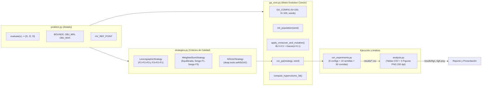

# Arquitectura del Software y Explicación Técnica del Código

Este documento detalla cómo está estructurado el repositorio y qué hace cada módulo de Python para garantizar que **la metaheurística base (Algoritmo Genético) sea 100 % idéntica** en los tres enfoques y **solo cambie la regla de evaluación de calidad y selección**.

---

## 1. Diagrama de Arquitectura Modular



---

## 2. Explicación Módulo por Módulo

### 2.1. `problem.py` — Aislamiento Matemático del Problema
- **Propósito:** Encapsular la función de evaluación multiobjetivo, los límites de las variables de decisión y los rangos de normalización para que puedan sustituirse por cualquier otra instancia sin tocar el algoritmo genético.
- **Elementos clave:**
  - `evaluate_smt(x)`: Recibe $\mathbf{x} = (s_1, s_2, s_3, s_4, v) \in [0, 1]^5$ y devuelve la tupla `(f1, f2, f3)`.
  - `evaluate_dtlz2(x)`: Problema benchmark alternativo con Frente de Pareto esférico analítico ($f_1^2 + f_2^2 + f_3^2 = 1$).
  - `normalize_objectives(f_vec)`: Normalización lineal min-max $\hat{f}_i = \frac{f_i - f_i^{\min}}{f_i^{\max} - f_i^{\min}} \in [0, 1]$.
  - `HV_REF_POINT = [6.0, 3.5, 1.5]`: Punto de referencia común documentado que domina estrictamente al punto nadir $[5.6, 3.2, 1.3]$.

### 2.2. `ga_core.py` — Núcleo del Algoritmo Genético
- **Propósito:** Garantizar igualdad de condiciones evolutivas entre métodos.
- **Control de aleatoriedad pareada:** Al iniciar `run_ga(strategy, seed)`, se fija `random.seed(seed)` y `np.random.seed(seed)`. De este modo, **para una misma semilla $s$, las 6 configuraciones parten exactamente de la misma población inicial $P_0$**.
- **Operadores genéticos idénticos (`apply_crossover_and_mutation`):**
  - **Cruza Blend (`tools.cxBlend` con $\alpha = 0.5$ y probabilidad $0.9$):** Genera hijos interpolando y extrapolando suavemente entre los genes de ambos padres, seguido de `clip_individual` para respetar $[0, 1]^5$.
  - **Mutación Gaussiana (`tools.mutGaussian` con $\mu=0, \sigma=0.1$ y probabilidad por gen $1/n_{\text{vars}} = 0.20$):** Introduce perturbaciones locales continuas respetando los límites $[0, 1]^5$.
- **Métricas exactas de dominancia e hipervolumen:**
  - `get_nondominated_vectors(obj_matrix)`: Identifica las soluciones no dominadas ($A \prec B$) y filtra duplicados numéricos.
  - `compute_hypervolume_3d(nd_points, ref_point)`: Calcula el volumen 3D exacto dominado por el conjunto no dominado respecto al punto de referencia común.

### 2.3. `strategies.py` — Las Tres Estrategias de Selección
Todas las clases implementan la misma interfaz (`prepare_population`, `select_parents`, `select_survivors`, `get_representative_solution`):

1. **`LexicographicStrategy`:**
   - Para evitar ciclos de intransitividad (*ciclos de Condorcet*) cuando se usa una tolerancia $\tau > 0$ en variables continuas, discretiza los objetivos normalizados en escalones de ancho relativo $\tau = 10^{-3}$:
     $$b_k(\mathbf{x}) = \left\lfloor \frac{\hat{f}_k(\mathbf{x})}{\tau} \right\rfloor$$
   - Si dos soluciones caen en el mismo escalón $b_{p_1}$ (es decir, empatan dentro del $0.1\%$ del rango del objetivo prioritario), se desempatan por el escalón del segundo objetivo $b_{p_2}$, luego por $b_{p_3}$, y finalmente por el valor exacto.
2. **`WeightedSumStrategy`:**
   - Calcula para cada individuo el valor escalarizado normalizado:
     $$F(\mathbf{x}) = w_1 \hat{f}_1(\mathbf{x}) + w_2 \hat{f}_2(\mathbf{x}) + w_3 \hat{f}_3(\mathbf{x}), \quad \sum_{i=1}^3 w_i = 1$$
   - Realiza torneo binario de padres y truncamiento elitista $R_t = P_t \cup Q_t$ conservando los $N=100$ menores valores de $F(\mathbf{x})$.
3. **`NSGA2Strategy`:**
   - Utiliza `deap.tools.selNSGA2` y `deap.tools.sortNondominated` para clasificar $R_t = P_t \cup Q_t$ en frentes de dominancia (Frente 1, Frente 2, ...) y asignar la distancia de hacinamiento (*crowding distance*).
   - Previene la pérdida artificial de diversidad filtrando clones exactos padre-hijo antes de aplicar `selNSGA2`, logrando mantener $\approx 100$ soluciones únicas distribuidas sobre el Frente 1.
   - Para efectos de comparación tabular con los métodos puntuales, `get_representative_solution` extrae del Frente 1 la solución compromiso de la región central (menor distancia euclidiana normalizada al punto ideal $(0,0,0)$).

### 2.4. `run_experiments.py` y `analysis.py`
- `run_experiments.py`: Ejecuta las $6 \times 10 = 60$ corridas y guarda toda la evidencia cruda en `results/runs_summary.csv`, `results/final_populations.csv` y `results/convergence_history.csv`.
- `analysis.py`: Lee los CSV, calcula medias, desviaciones estándar e indicadores de sesgo en `results/metrics_comparison.csv`, y renderiza las 5 figuras a `200 dpi`.

---

## 3. Guía Paso a Paso para Acoplar el Problema Oficial del Profesor

Cuando el profesor entregue el código de la instancia oficial del equipo:

1. Abrir únicamente `problem.py`.
2. Sustituir el cuerpo de `evaluate(x)` por el cálculo de los objetivos del problema oficial (recordando que si algún objetivo original es de **maximizar**, basta con multiplicar su valor por $-1$ o invertirlo para mantener el estándar de **minimización** en todos los objetivos).
3. Actualizar en `problem.py`:
   - `N_VARS` y `VAR_NAMES`
   - `BOUNDS` (límites inferior y superior de cada variable)
   - `OBJ_MIN` y `OBJ_MAX` (límites estimados o analíticos para la normalización min-max)
   - `HV_REF_POINT` (un punto ligeramente peor que el máximo de cada objetivo).
4. Ejecutar en terminal:
   ```bash
   python run_experiments.py
   python analysis.py
   ```
   ¡Sin modificar una sola línea de `ga_core.py` ni de `strategies.py`, tendrás todas las métricas y gráficas actualizadas!
